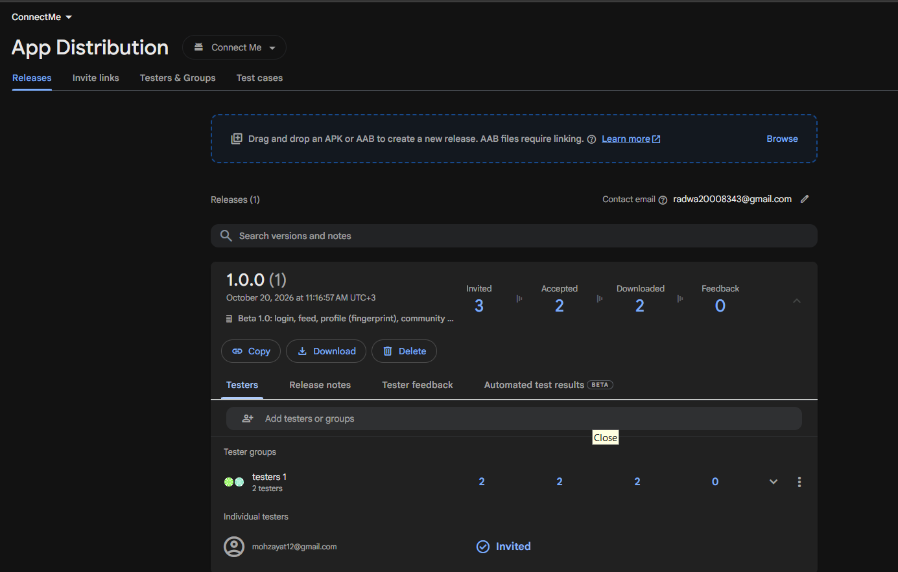

# ConnectMe Community App

A Flutter community app inspired by the *Social App – Free UI Kit* Figma design.
Members sign up, read a live feed of posts, publish their own, open a
fingerprint-protected profile and see where other members are on a map.

Built as the final capstone: **Firebase + native device features + design
patterns + Clean Architecture + beta distribution**.

## Screenshots

| Login | Sign Up | Home feed |
|---|---|---|
|  |  |  |

| Biometric prompt | Profile | Community map |
|---|---|---|
|  |  |  |

## Features

- **Authentication** (Firebase Auth, email + password)
  - Sign Up validation: full name starts with a capital letter, email contains `@`, password of at least 6 characters, confirm password must match.
  - Firebase errors are shown as friendly messages in the UI.
  - The session is persisted: a signed-in user skips the login screen on restart.
- **Home feed** (Cloud Firestore)
  - Posts update in real time, each showing author, text and time.
  - A floating button opens a form to publish a new post.
  - If Firestore cannot be reached, the last posts saved on the phone are shown.
- **Profile** (device features)
  - The profile icon asks for the **fingerprint** (`local_auth`) before the screen opens.
  - Shows the photo, name, email, and the phone's **model and Android version** (`device_info_plus`).
  - "Change photo" picks an image from the gallery (`image_picker`), saves it in Firestore and updates the screen immediately.
- **Community map** (`google_maps_flutter`)
  - Full-screen map titled "Community Map" with markers for members in four cities; tapping a marker shows the member's name and city.

## Architecture

The project follows **Clean Architecture**. Dependencies point inward only:

```
Presentation (screens, widgets, Cubits)  →  Domain  ←  Data (Firestore, local cache)
```

| Layer | Contains |
|---|---|
| **Domain** | Pure Dart: entities (`AppUser`, `Post`, `Member`, `DeviceDetails`), the `PostRepository` contract, use cases (`GetPosts`, `CreatePost`) |
| **Data** | `PostModel` / `UserModel` with `fromJson` / `toJson`, data sources (Firestore, local cache), `PostRepositoryImpl` |
| **Presentation** | Screens, widgets and Cubits (`AuthCubit`, `PostCubit`, `ProfileCubit`) |
| **Services** | The only classes that talk to Firebase and device plugins: `AuthService`, `FirestoreService`, `ProfileService`, `BiometricService`, `DeviceInfoService`, `PhotoPickerService` |

State management: **flutter_bloc (Cubit)**. Dependency injection: **GetIt**, all
wiring in [`lib/injection.dart`](lib/injection.dart).

### Design patterns

| Pattern | Where | Why |
|---|---|---|
| **Singleton** | `services/firestore_service.dart` | One Firestore connection shared by the whole app |
| **Factory** | `data/datasources/post_datasource_factory.dart` | The repository asks for a source (remote or local) and never builds concrete classes itself |
| **Builder** | `domain/entities/user_builder.dart` | Builds the user with only the fields we have (uid, name, email at sign-up; the photo later) |

### Project structure

```
lib/
├── main.dart, app.dart, injection.dart, firebase_options.dart
├── core/
│   ├── constants/community_members.dart
│   ├── errors/failures.dart, firestore_error_mapper.dart
│   ├── theme/app_colors.dart, app_theme.dart
│   └── utils/validators.dart, date_formatter.dart
├── data/
│   ├── datasources/        post_datasource, firestore_post_datasource,
│   │                       local_post_datasource, post_datasource_factory
│   ├── models/             post_model, user_model
│   └── repositories/       post_repository_impl
├── domain/
│   ├── entities/           user, user_builder, post, member, device_details
│   ├── repositories/       post_repository
│   └── usecases/           get_posts, create_post
├── presentation/
│   ├── blocs/              auth, post and profile cubits + states
│   ├── screens/            auth_gate, login, sign_up, home, create_post, profile, map
│   └── widgets/            shared UI (post_card, gradient_button, ...)
└── services/               auth, firestore, profile, biometric, device_info, photo_picker
test/                       validators, date_formatter, user_builder, firestore_error_mapper
```

## Firestore data

| Collection | Document | Fields |
|---|---|---|
| `posts` | auto id | `id`, `authorId`, `authorName`, `content`, `createdAt` (milliseconds) |
| `users` | the user's uid | `uid`, `fullName`, `email`, `photoBase64` (resized photo, created when the user picks one) |

Security rules are in [`firestore.rules`](firestore.rules): only signed-in users
can read; a post can only be created under your own uid (1–500 characters);
posts cannot be edited or deleted; each user can only write their own profile.

## Permissions

| Permission | Why |
|---|---|
| `android.permission.INTERNET` | Firebase (Auth, Firestore) and Google Maps tiles |
| `android.permission.USE_BIOMETRIC` | Fingerprint check before opening the profile |

The gallery is opened through the system picker, and the map does not show the
user's own location, so no storage, camera or location permission is declared.
<!-- TODO: run `aapt dump permissions app-release.apk` and add any extra
     permission that libraries merge into the final manifest. -->

## Getting started

Requirements: Flutter SDK, an Android phone (or emulator) with a **fingerprint
enrolled** to try the profile.

```bash
flutter pub get
flutter run
```

- Firebase is already configured (`firebase_options.dart`, `google-services.json`). Create an account from the Sign Up screen.
- **Google Maps key:** the key in `android/app/src/main/AndroidManifest.xml` is for evaluation only and will be revoked after grading. To use your own, replace the value of `com.google.android.geo.API_KEY` (Maps SDK for Android must be enabled).

Quality checks:

```bash
dart format .
flutter analyze
flutter test
```

## Beta distribution (Firebase App Distribution)

<!-- TODO: finish with the real steps and screenshots after distributing. -->

1. Build the release APK: `flutter build apk --release`
2. Firebase Console → **App Distribution** → upload `build/app/outputs/flutter-apk/app-release.apk`.
3. Add at least two tester emails and distribute.
4. Testers receive an invitation email, accept it and install the build.

| Dashboard with the APK and two testers | Tester invitation email |
|---|---|
|  |  |

## Tech stack

Flutter · Dart · Firebase Auth · Cloud Firestore · Firebase App Distribution ·
flutter_bloc · GetIt · local_auth · device_info_plus · image_picker ·
google_maps_flutter · shared_preferences · google_fonts